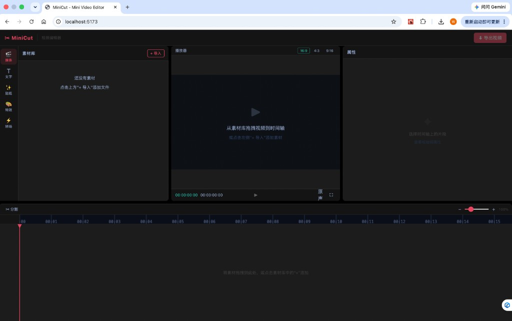
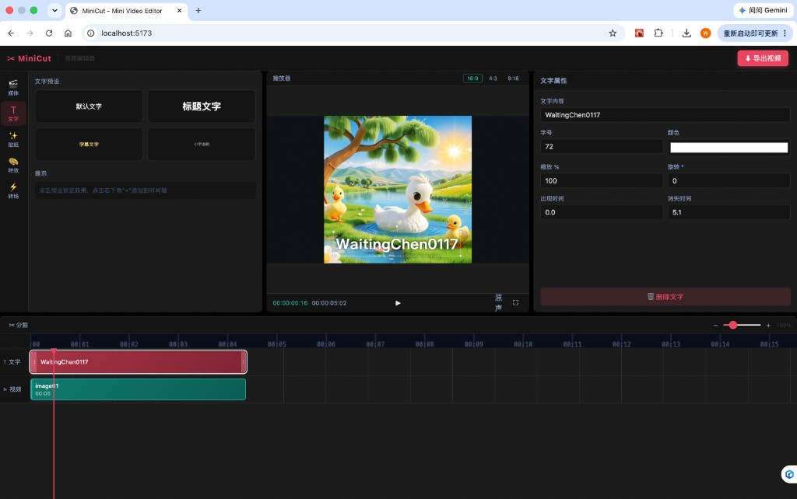
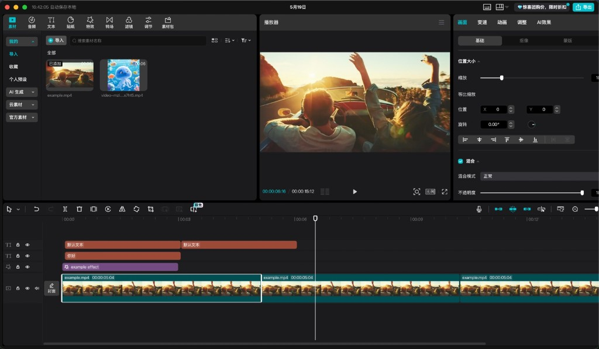

# MiniCut

浏览器里的迷你视频编辑器，布局参考剪映：左侧素材、中间预览、右侧属性、底部时间轴。

技术栈：React 18、TypeScript、Vite、Zustand。

## 界面

空项目时，左侧是素材库，中间是预览，右侧是属性，底部是时间轴。



导入图片并加上文字后，可以在右侧改内容、字号、颜色、缩放和出现时间。



## 布局参考

分区方式参考剪映：素材在左，播放器在中，属性在右，多轨时间轴在下。下图是剪映的界面，只作对照。



## 功能

- 导入本地视频、音频、图片，拖到时间轴
- 片段可移动、换轨道、两端裁剪；按 `B` 或工具栏按钮在播放头处分割
- 文字预设可预览并加到时间轴，支持拖动、缩放、旋转
- 左右面板和时间轴高度可拖拽调整
- 导出为 `minicut-export.webm`（用画布录制，时长与时间轴一致）

贴纸、特效、转场目前是占位入口。

## 本地运行

需要 Node.js 18 及以上。

```bash
npm install
npm run dev
```

其他命令：

```bash
npm run build    # 类型检查并构建
npm run preview  # 预览构建结果
npm test         # 跑单元测试
```
